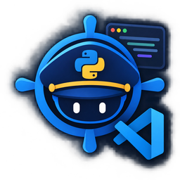

<p align="center">
  
</p>

# PyPilot for VS Code

<p align="center">
  <a href="https://marketplace.visualstudio.com/items?itemName=AbdullahMasood-005.pypilot-vscode"></a>
  <a href="https://marketplace.visualstudio.com/items?itemName=AbdullahMasood-005.pypilot-vscode"></a>
  <a href="https://marketplace.visualstudio.com/items?itemName=AbdullahMasood-005.pypilot-vscode&ssr=false#review-details"></a>
  <a href="https://open-vsx.org/extension/AbdullahMasood-005/pypilot-vscode"></a>
  <a href="https://github.com/pypilot-dev/pypilot-vscode/blob/master/LICENSE"></a>
  <a href="https://github.com/pypilot-dev/pypilot-vscode"></a>
</p>

> ⭐ **Enjoying PyPilot?** If it saved you from a broken environment, please [star it on GitHub](https://github.com/pypilot-dev/pypilot-vscode) or [leave a rating](https://marketplace.visualstudio.com/items?itemName=AbdullahMasood-005.pypilot-vscode&ssr=false#review-details). It's free and it helps other Python developers find it.

PyPilot inspects Python projects, figures out which Python versions your dependencies actually support, and creates a working virtual environment. It resolves driver and CUDA compatibility for PyTorch or TensorFlow, checks package wheels on PyPI, and flags broken imports directly in the editor without external API calls.

This extension runs the same native Rust engine as [PyPilot for Zed](https://github.com/pypilot-dev/pypilot), integrated with VS Code surfaces: the command palette, status bar, progress indicators, interactive doctor report panel, and workspace tasks.

## Features

- **Environment setup**: Runs `uv init` and `uv add` when no `pyproject.toml` exists. In pip mode, records installations using `pip freeze > requirements.txt`.
- **Python version resolution**: Evaluates PyPI wheel availability against `requires_python` to find an interpreter version that satisfies all dependencies.
- **Hardware matching**: Inspects host NVIDIA drivers via `nvidia-smi` and aligns `torch` or `tensorflow` with the correct CUDA runtime wheel.
- **Import diagnostics**: Flags missing or incompatible package imports in open files, with quick fixes to install or resolve them.
- **Onboarding prompt**: Scans opened folders and displays an actionable alert when environment issues need attention.
- **Status bar**: Displays the environment state with quick access to the report. Its tooltip shows the Python version, the environment path, the package manager PyPilot uses (`uv`, `uv-pip`, `pip` or `pixi`) and, in pixi projects, the pixi environment, read from files on disk without starting any process.
- **Task integration**: Provides workspace task definitions for environment bootstrap, health checks, and package maintenance.
- **Report panel**: Renders the doctor report in an interactive webview panel with fix buttons, **Copy as Markdown** and **Save as HTML** (a standalone page with inline styles in your current theme colors, no scripts).
- **Multi-root workspaces**: Each workspace folder with a Python project gets its own language server, settings and interpreter selection (see below).
- **Relevant commands only**: Project-specific commands are hidden from the Command Palette where they cannot apply (see the table below).

## Requirements

- VS Code 1.85 or later.
- Network access during initial startup to download the native `pypilot` helper binary (approximately 3 MB), unless `pypilot` is already on `PATH` or `pypilot.helperPath` is set. Behind a proxy, VS Code's `http.proxy` (or the system proxy) is used; with `http.proxySupport` set to `off`, the `HTTPS_PROXY` / `NO_PROXY` environment variables are.
- Python does not need to be installed beforehand when using `uv` mode; `uv` downloads required interpreters directly.

## Getting started

1. Open a Python project directory in VS Code.
2. PyPilot activates and scans the environment.
3. If an issue is found, a prompt appears with options to run the automatic fix or inspect the report.
4. The environment is configured for the Python version supported by your project dependencies.

The same steps are in the **Get started with PyPilot** walkthrough (Help > Welcome).

## pixi projects

A folder with a `pixi.toml`, or a `pyproject.toml` with `[tool.pixi.workspace]`, is treated as a pixi project:

- The environment lives in `.pixi/envs/<name>`, where `<name>` is `pypilot.pixiEnvironment` (`default` unless set).
- PyPilot never creates a `.venv` there and never touches `pixi.lock`.
- Package installs go through `pixi add --pypi`.

## Multi-root workspaces

In a window with several folders, PyPilot runs one language server per folder that holds a Python project (a `pyproject.toml`, `requirements.txt`, `pixi.toml`, `environment.yml`, `setup.py`, `setup.cfg`, `Pipfile`, or any `.py` / `.ipynb` file). A folder without one gets a server as soon as you open a Python file from it.

- Each server checks only its own folder's files and uses that folder's settings (`pypilot.*` settings can differ per folder) and environment. Interpreter selection (`pypilot.autoSelectVenv`) works per folder too.
- Commands act on the folder of the active editor. With no editor open, PyPilot asks which folder to use. Quick fixes in the editor go to the server of the file's folder.
- A folder nested inside another workspace folder is handled by the outer one.
- Tasks (**Tasks: Run Task**) are listed per folder.
- Each server checks its folder on startup, so you may see one notification per folder.

A single-folder window works as before: one server, which also checks Python files opened from outside the folder.

## Commands

Commands marked "Only when..." are hidden from the Command Palette in workspaces where they do not apply. They still run from the walkthrough, keybindings and the report panel.

| Command | Action |
|---|---|
| `PyPilot: Set Up Environment` | Bootstraps the environment, installs Python if needed, and installs dependencies |
| `PyPilot: Doctor: Show Environment Report` | Runs a health check and opens the report as a Markdown document (its editor title button opens it in the report panel) |
| `PyPilot: Fix Python Version` | Recalculates compatible versions and rebuilds the virtual environment |
| `PyPilot: Fix CUDA / PyTorch Build` | Re-pins machine learning dependencies to the driver-supported build. Only when a manifest (`pyproject.toml`, `requirements*.txt`, `pixi.toml`, `environment.yml`) names `torch` or `tensorflow` |
| `PyPilot: Check Package Compatibility...` | Checks whether a specific package runs on the current Python version |
| `PyPilot: Install Package...` | Installs a package and updates the project manifest |
| `PyPilot: Update Bundled Data Tables` | Updates cached hardware and framework compatibility data |
| `PyPilot: Migrate Conda environment.yml to pyproject.toml` | Translates conda environment definitions into pyproject.toml. Only when an `environment.yml` (or `.yaml`) exists |
| `PyPilot: Open Environment Report Panel` | Runs the health check and shows the report in the webview panel, with fix buttons, **Copy as Markdown** and **Save as HTML** |
| `PyPilot: Install uv Globally` | Installs `uv` so it is available outside this workspace |
| `PyPilot: Install pixi` | Installs [pixi](https://pixi.sh) with its official installer. Only when pixi is not found on `PATH` or in `~/.pixi/bin` |
| `PyPilot: Initialize pixi project` | Shows the `pixi.toml` PyPilot would write for this project, then writes it (optionally running `pixi install`) only after you confirm. Only when a folder is not a pixi project yet |
| `PyPilot: Check for Helper Updates` | Offers the engine version this extension pins when it is newer than the helper in use (with `pypilot.engineUpdates: "latest"`, also newer GitHub releases) |
| `PyPilot: Use Project Environment (.venv / pixi)` | Makes the workspace's `.venv` (or the pixi environment set in `pypilot.pixiEnvironment`) the active Python interpreter |

## Settings

| Setting | Default | Description |
|---|---|---|
| `pypilot.helperPath` | `""` | Path to a `pypilot` executable to use instead of the downloaded engine (for example a local `cargo build`). It must answer `--version`; while set, nothing is downloaded and no engine updates are offered. Machine setting: a workspace cannot set it. |
| `pypilot.engineUpdates` | `"pinned"` | `pinned` offers only the engine version this extension release pins (updating the extension brings newer engines). `latest` also offers newer engine releases from GitHub; those are verified against the release's `SHA256SUMS` and refused if it has none. |
| `pypilot.packageManager` | `"auto"` | `auto` (use `uv` when it is installed, offer to install it, otherwise fall back to `pip`), `uv` project mode, `uv-pip`, `pip`, or `pixi` (environment in `.pixi/envs/<name>`, installs via `pixi add --pypi`). pixi projects use pixi in `auto` mode too. |
| `pypilot.notifications` | `"problems-only"` | Configures notification verbosity: `all`, `problems-only`, or `off`. |
| `pypilot.autoCheckOnOpen` | `true` | Automatically checks the environment when opening a workspace. |
| `pypilot.autoSelectVenv` | `true` | Makes the workspace's `.venv` the active Python interpreter when it is created or changed, and on startup when no interpreter inside the workspace is selected. pixi projects (`pixi.toml`, or `[tool.pixi.workspace]` in `pyproject.toml`) are supported: the environment named by `pypilot.pixiEnvironment` (`.pixi/envs/<name>`) is selected after `pixi install`, and no `.venv` is used. |
| `pypilot.pixiEnvironment` | `"default"` | Which pixi environment PyPilot and the interpreter selection use in multi-environment pixi projects (for example `cuda`). Install it with `pixi install -e <name>`. Ignored outside pixi projects. |
| `pypilot.diagnosticsScope` | `"openFiles"` | `openFiles` checks imports only in open files. `workspace` also scans every Python file in the background, so the Problems panel lists problems in files you have not opened. Needs a helper that supports it; older helpers keep checking open files only. |
| `pypilot.dataRefreshDays` | `7` | Refresh interval in days for compatibility data tables (0 disables updates). |

## Architecture

The extension is a TypeScript client wrapping the native Rust `pypilot` helper binary. On startup it uses `pypilot.helperPath` when set; otherwise the newer of a `pypilot` on PATH and the copy in the extension's storage; otherwise it downloads the engine version pinned in `package.json`. The helper communicates over standard I/O via the Language Server Protocol.

### Engine pin and verification

`package.json` carries the engine pin, which the engine's release workflow bumps on each release:

```json
"pypilotEngine": { "version": "1.2.2", "sha256": { "pypilot-windows-x64.zip": "<hex>", "...": "..." } }
```

Every download is hashed before anything is extracted. The pinned version must match the SHA-256 in `package.json`; any other version (`pypilot.engineUpdates: "latest"`) must match the release's `SHA256SUMS` asset (`<sha256>  <asset>` per line). On a mismatch the archive is deleted and nothing is installed; a release without `SHA256SUMS` is refused. There is no switch to install unverified engines: build one yourself and use `pypilot.helperPath` instead. The "PyPilot" output channel logs which helper is used and which checksum each download matched.

Settings reach the helper two ways: `initializationOptions` at startup (`pixiEnvironment`, `diagnosticsScope`) and the whole `pypilot` settings section through `workspace/didChangeConfiguration` (`settings.pypilot.<key>`), sent once after startup and on every change. In multi-root windows both are read for the server's folder.

```
pypilot-vscode/
├── src/
│   ├── extension.ts        Activation and onboarding flow
│   ├── clients.ts          One language client per workspace folder, server command routing
│   ├── downloader.ts       Helper resolution, pinned/verified engine downloads, update offers
│   ├── engine.ts           Engine pin, versions, SHA-256 and SHA256SUMS checks (no vscode import)
│   ├── net.ts              HTTPS requests, redirects, proxy tunnel (no vscode import)
│   ├── statusBar.ts        Status bar indicator and environment tooltip
│   ├── commands.ts         Command palette actions
│   ├── project.ts          File-based project checks and the palette context keys
│   ├── report.ts           Feeds the server's report Markdown to the report panel
│   ├── tasks.ts            Workspace task provider
│   ├── venv.ts             .venv / pixi env auto-selection via the Python extension APIs
│   └── webview/
│       └── reportPanel.ts  Doctor report webview, Markdown copy and HTML export
├── build.ts                Bun build script
├── bunfig.toml
└── package.json
```

## Development

Build and package scripts use Bun:

```bash
# Install dependencies
bun install

# Compile extension
bun run build

# Watch mode during development
bun run build --watch

# Build vsix package
bun run package

# Unit tests (engine pin, verification, HTTP, report HTML)
bun test

# End-to-end in a real VS Code 1.85 (downloads VS Code; Linux needs xvfb-run -a)
bun run e2e
# ... hiding any installed pypilot, so activation downloads the pinned engine
PYPILOT_E2E_FRESH=1 bun run e2e
```

## Support the project

PyPilot is free and open source, built and maintained in spare time. If it helps you:

- ⭐ [Star it on GitHub](https://github.com/pypilot-dev/pypilot-vscode): it's the easiest way to show support.
- 📝 [Rate it on the Marketplace](https://marketplace.visualstudio.com/items?itemName=AbdullahMasood-005.pypilot-vscode&ssr=false#review-details): reviews help others decide to try it.
- 🐛 [Report a bug or request a feature](https://github.com/pypilot-dev/pypilot-vscode/issues): reproducible environment problems are especially welcome.

## License

Apache-2.0. See the project repository license for details.
